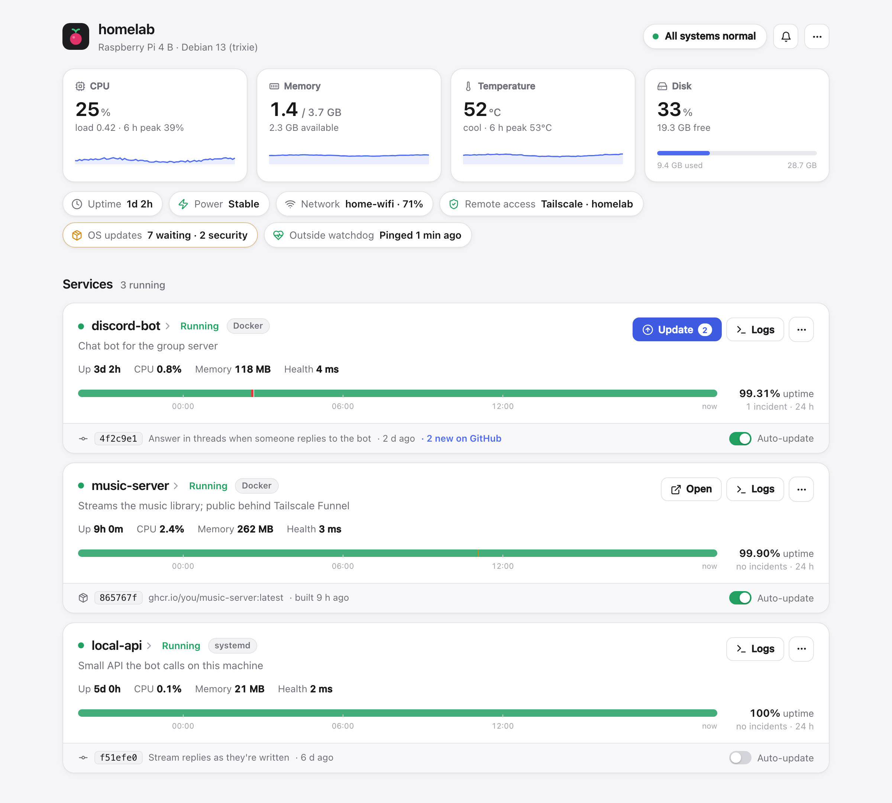
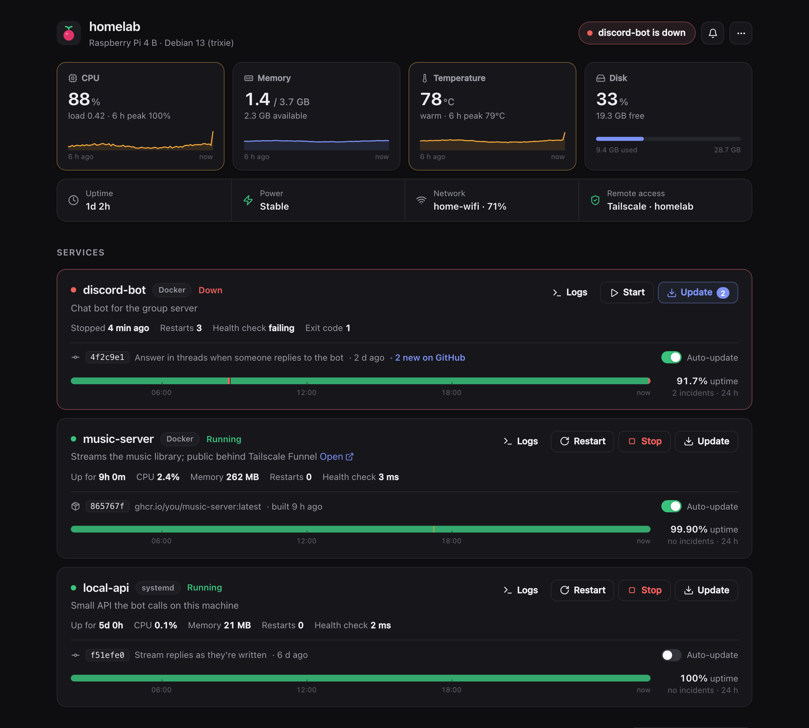
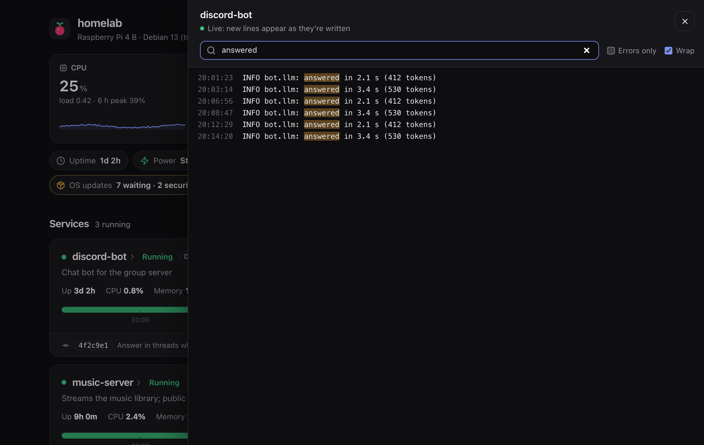
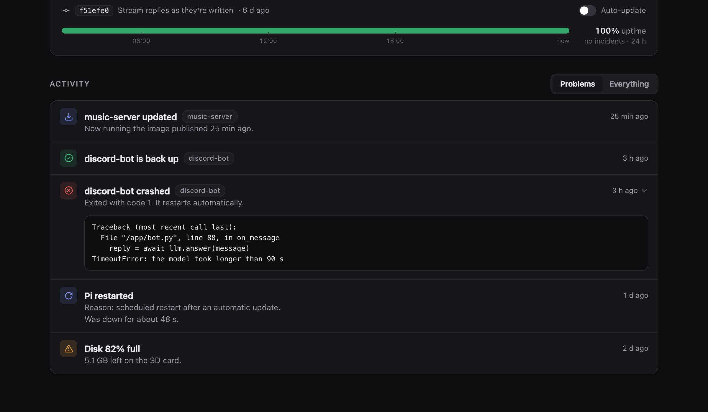
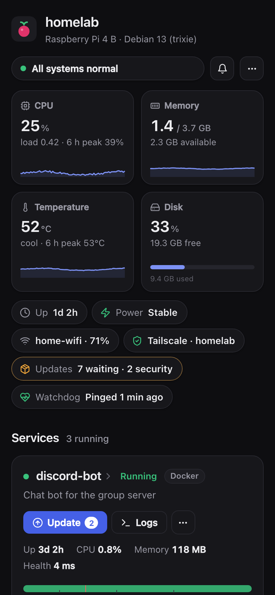

# pi-dash

A small dashboard and Discord alerter for the services on a home server such as a Raspberry Pi. One page shows every service and the machine itself; Discord tells you when something needs you, and stays quiet otherwise.

No dependencies: Python 3.11+ standard library and one static page (the optional assistant adds one Python package, kept in its own environment). It uses about 30 MB of memory and under 1 % CPU on a Pi 4.

<picture>
  <source media="(prefers-color-scheme: dark)" srcset="docs/overview-dark.png">
  
</picture>

## What it does

- **Services** (Docker Compose, systemd user or system units): running state, a 24 h uptime timeline, CPU and memory, health check, the commit or image that's running and whether a newer one exists. Live logs with search; start, stop, restart and update buttons.
- **A page per service** (click its card): uptime, CPU, memory and health-check response time over 6 h, 24 h or 7 days; the commits an update would bring; everything that happened to it; how it's set up.
- **Scheduled jobs**: systemd timers and cron jobs, with their last runs, how long they took and when they're next due.
- **The machine**: CPU, memory, temperature and network traffic over the last 6 h (with internet outages marked), space on each drive (the SD card and any USB drives), power (Raspberry Pi under-voltage), Wi-Fi, Tailscale, waiting OS updates. Restart or shut down from the menu. Switch Wi-Fi networks from the network chip: if the new one doesn't connect or has no internet within about a minute, the Pi goes back to the one it was on.
- **Discord alerts**, only when something is wrong: a crash (with its last log lines), errors in a service's log, a service down or back up, memory that keeps growing, a scheduled job that failed or didn't run, a drive filling up or one in `/etc/fstab` that isn't mounted, overheating, low power, failed systemd units or automatic updates, an internet outage (once it's back), and every restart of the machine with the reason. Alerts held back while offline go out once per kind, stamped with when they happened. Red alerts can @mention you. A morning summary, and a mute switch for when you're tinkering.
- **An outside heartbeat**, optional: a service such as healthchecks.io hears from the Pi every 2 minutes and tells you when it stops, so a Pi that lost power doesn't just go quiet.
- **Auto-update**: every 5 minutes it checks for a new commit (services built from a git checkout) or a newly published image (services that pull one). If there is one it runs the service's update steps, waits for it to come back healthy, and tells you. A version that fails isn't retried until a newer one appears. It can be switched off per service. Once a Docker service's update works, and once a day, old images and all but the most recent 1 GB of build cache are removed, so updates don't slowly fill the SD card (`prune_images` and `build_cache_gb` in the config).
- **An assistant**, optional: ask Claude why something broke, or to do a chore like installing updates. It reads logs, files and status on its own; anything that changes the Pi appears as the exact command, with what it will do, and runs only when you press Run. See [The assistant](#the-assistant).

When something breaks, the header, the card and the history say so, and Discord pings you:



| Live logs, with search and an errors-only filter | Activity, with the log lines behind each alert |
|---|---|
|  |  |



## Security model

The dashboard can stop, restart and update your services, so keep it private:

- Reach it over a VPN such as [Tailscale](https://tailscale.com), and keep the port closed to everything else with a firewall (`ufw default deny incoming`, then `ufw allow in on tailscale0`).
- Set a password unless you're the only one who can reach it: `install.sh` offers to, or later `python3 -m pidash.passwd`. It's stored as a scrypt hash; signing in gives a 30-day HttpOnly session, and repeated wrong guesses are locked out. Requests from the server itself (curl on localhost) don't need it.
- For HTTPS inside your tailnet: `sudo tailscale serve --bg --https=9443 http://127.0.0.1:9000`, then open `https://<machine>.<tailnet>.ts.net:9443`.
- Never expose it with Tailscale Funnel, port forwarding or a public reverse proxy.

The assistant can run anything as root once you approve it, so it has extra limits:

- It only answers over Tailscale: from a tailnet address (100.64.0.0/10), or relayed by `tailscale serve`. Requests from the LAN, from containers, or from a program on the Pi calling localhost directly are refused, even without a password. (A program already running as your user could fake the relay header, but such a program can use your sudo anyway.)
- It runs commands on its own only when every part is on a short read-only list (reading files and logs, status and list commands, piped through grep and the like). Anything else, including `sudo`, `;`, `&&`, redirects, `$(...)` and files that may hold secrets, waits for you. The rules are in [pidash/policy.py](pidash/policy.py).
- Tokens, passwords, API keys and webhook URLs are replaced with `[hidden]` in everything it reads. What it reads, including logs, goes to Anthropic's API.
- Logs can contain text written by strangers (people messaging a bot, visitors to a public site). The assistant is told to treat it as data and to flag anything that tries to give it orders. Either way, nothing changes without your click.
- Every command you approve is recorded in Activity, with its output.

The API only answers requests addressed to this machine's own names (against DNS rebinding) and only accepts changes that carry a custom header (against cross-site requests). It runs as your user; root is limited by `/etc/sudoers.d/pi-dash` to rebooting, shutting down and starting, stopping or restarting units. On machines with NetworkManager, `/etc/polkit-1/rules.d/50-pi-dash.rules` also lets it scan for and switch Wi-Fi networks.

## Install

On the server (Debian, Ubuntu or Raspberry Pi OS with systemd):

```bash
git clone https://github.com/Xiao215/pi-dash ~/services/pi-dash
cd ~/services/pi-dash && ./install.sh
```

`install.sh` asks for your Discord webhook and user ID (both optional), writes `/etc/pi-dash/config.toml`, installs the `pi-dash` systemd service running as you, and starts it on port 9000. Run it again after changing the service template; it keeps your settings.

Settings are in `/etc/pi-dash/config.toml` (see [config.example.toml](config.example.toml)): port, Discord webhook and pings, schedule, thresholds. Restart after editing: `sudo systemctl restart pi-dash`.

## The assistant

Turn it on by running `./install.sh` again and answering yes. It runs on an [Anthropic API key](https://console.anthropic.com), or on your Claude Pro/Max plan through [cli-bridge](https://github.com/Xiao215/cli-bridge) when that runs on the same machine (the installer offers it; in the config that's `base_url = "http://127.0.0.1:8787"` with no key). Or set `enabled = true` and `api_key` under `[assistant]` in `/etc/pi-dash/config.toml`, install the package with `python3 -m venv --system-site-packages .venv && .venv/bin/pip install "anthropic>=1.17,<2"`, and run `./install.sh` so the service uses it.

Open it with **Ask** in the header, by pressing `/`, or with **Ask why this happened** under a problem in Activity. It sees what the dashboard sees. To find out more it reads logs and runs commands that only look, and the "Looked at" box shows each one with its output. When something needs changing it shows a card with the command, what it expects to happen (what restarts, whether your connection may drop, whether a reboot is needed after), and **Run**, **Edit** and **Not now** buttons.

Approved commands run as `systemd --user` units, so they keep going when the page closes, Tailscale restarts or pi-dash itself restarts. They run in a terminal, so their output streams onto the card as it's written; if one asks a question, type the answer in the box under its output (password prompts stay hidden). **Stop** ends them. Commands that start with `sudo` need passwordless sudo for your user, which Raspberry Pi OS has by default.

Settings: `model` (default `claude-opus-5-5`), `effort` (`low`, `medium` or `high`) and `daily_budget_usd` (default 3). With an API key the panel shows what each chat cost (a typical question costs a few cents), and new answers wait once the day's budget is spent. Through cli-bridge it shows tokens instead, and your plan's own limits apply.

## Adding services

List them in `~/services/services.json`; [examples/services.example.json](examples/services.example.json) shows the three kinds:

| Field | |
|---|---|
| `name`, `description` | shown on the card |
| `kind` | `compose`, `systemd-user` or `systemd` |
| `dir` | the service's folder; update steps run here |
| `container` / `unit` | the container (compose) or unit (systemd) to watch |
| `health` | optional URL that answers 2xx while healthy |
| `check` | optional `{"command", "problem", "every"}`: a command that must succeed, e.g. "is it logged in?"; when it fails the card turns amber and shows `problem` |
| `update` | shell steps for the Update button and auto-update |
| `repo` | the git checkout inside `dir`, if not `dir` itself |
| `url` | optional link on the card |

Then reload the list: `curl -X POST -H 'X-Pi-Dash: 1' http://localhost:9000/api/reload`.

## Scheduled jobs

Add backups, syncs and other periodic work under `"jobs"` in the same file (see the example). Each job is one of two kinds:

- **A systemd timer**: `"timer": "backup.timer"` (and `"user": true` for a `systemctl --user` timer). pi-dash reads every run from systemd: when it started, how long it took, its exit code. The card gets Logs and Run now buttons.
- **Anything else** (cron, a script on another machine): it reports each run to `/api/ping/<name>`, optionally with an exit code and its output. From the Pi itself no password or header is needed:

  ```bash
  0 */6 * * * out=$(/home/pi/bin/sync-photos 2>&1); curl -fsS --data-binary "$out" localhost:9000/api/ping/photo-sync/$?
  ```

  `/api/ping/<name>` alone means it worked; `/<exit code>` or `/fail` reports a failure, and the body becomes the log lines in the alert.

| Field | |
|---|---|
| `name`, `description` | shown in the list |
| `timer`, `user` | the systemd timer, and whether it's a user timer |
| `service` | the unit the timer starts, if not the timer's name with `.service` |
| `every` | how often it should run (`"30m"`, `"6h"`, `"1d"` or seconds); with it, pi-dash alerts when a run is missed |
| `grace` | how late a run may be before that counts as missed (default 10 % of `every`, at least 10 min) |

A failed run alerts you with its last log lines; so does a missed one, and a timer that was switched off. Their failures aren't reported a second time as crashed or failed units.

Tips: give containers `restart: unless-stopped` and a fixed `container_name`. Send Docker logs to journald (`"log-driver": "journald"` in `/etc/docker/daemon.json`) so the dashboard can show and watch them. Published Docker ports bypass ufw; prefer `network_mode: host` or binding to `127.0.0.1`.

## Knowing when the Pi is off

The Discord alerts come from the Pi, so if it loses power or its connection, they stop, which looks the same as all being well. For that case, make a check on an outside service, for example [healthchecks.io](https://healthchecks.io) (free; it can alert you on Discord, by email or on your phone) or a "push" monitor in Uptime Kuma, and put its ping URL in `config.toml`:

```toml
[heartbeat]
url = "https://hc-ping.com/your-check-id"
every = 120
```

pi-dash pings it every 2 minutes for as long as its own checks keep running; set the check's period a little longer, e.g. 5 minutes. The dashboard shows when the last ping went out.

## Updating pi-dash

```bash
git -C ~/services/pi-dash pull --ff-only && sudo systemctl restart pi-dash
```

State (activity feed, uptime samples) lives in `/var/lib/pi-dash` and is pruned after 7 days.

## Development

```bash
python3 -m unittest discover -s tests   # unit tests; no Pi needed
node --check static/app.js
```

To work on the page without a server, run the demo: it serves the real page with made-up data.

```bash
python3 tools/demo.py              # http://localhost:9100
python3 tools/demo.py --trouble    # a service down, a hot CPU
```

`tools/screenshots.cjs` regenerates the images in `docs/` from the demo (needs Playwright). The watchers need systemd, journald and Docker, so try those changes on the server itself.

## License

MIT
